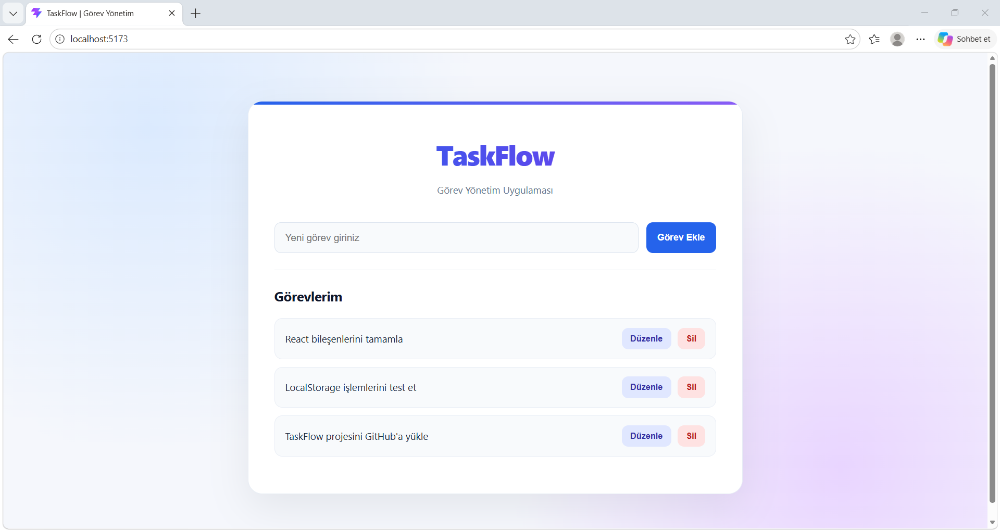
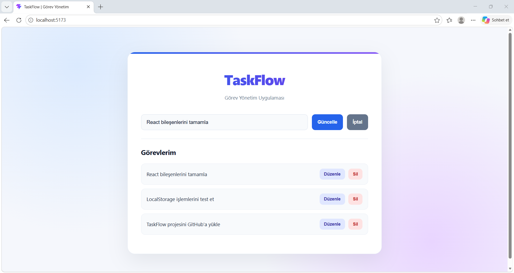

# TaskFlow - Görev Yönetim Uygulaması

TaskFlow, React ve JavaScript kullanılarak geliştirilmiş,
modern ve kullanıcı dostu bir görev yönetim uygulamasıdır.

Bu proje, TNC Group / Software Persona Web Geliştirme
eğitim programı kapsamında hazırlanmıştır.

## Özellikler

- Yeni görev oluşturma (Create)
- Görevleri listeleme (Read)
- Mevcut görevleri güncelleme (Update)
- Görev silme (Delete)
- LocalStorage ile görevleri tarayıcıda saklama
- Görev düzenleme işlemini iptal etme
- Boş görev listesi bilgilendirmesi
- Mobil uyumlu (Responsive) tasarım

## Kullanılan Teknolojiler

- React
- JavaScript (JSX)
- HTML5
- CSS3 (Pure CSS)
- Vite
- LocalStorage

## Proje Yapısı

```text
src/
├── components/
│   ├── TaskForm.jsx
│   ├── TaskItem.jsx
│   └── TaskList.jsx
├── App.jsx
├── index.css
└── main.jsx
```

## Kurulum

Projeyi bilgisayarınızda çalıştırmak için:

1. Proje klasörüne girin.
2. Gerekli paketleri yükleyin:

```bash
npm install
```

3. Geliştirme sunucusunu başlatın:

```bash
npm run dev
```

4. Terminalde gösterilen yerel adresi tarayıcıda açın.

## Production Build

Üretim sürümünü oluşturmak için:

```bash
npm run build
```

Derlenen dosyalar `dist` klasöründe oluşturulur.


## Ekran Görüntüleri

### Ana Ekran



### Görev Düzenleme




## Veri Saklama

Görevler tarayıcının LocalStorage alanında saklanır.
Böylece sayfa yenilendiğinde görevler korunur.

Uygulama, backend sunucusu veya harici veritabanı
gerektirmeden çalışır.

## Proje Amacı

Bu projenin amacı React bileşen yapısını,
JavaScript ile CRUD işlemlerini, CSS tasarımını
ve LocalStorage kullanımını uygulamalı olarak
pekiştirmektir.

## Geliştirici

Ahmet Taş

Bilgisayar Mühendisi
